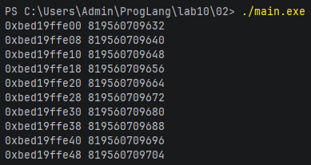

# Языки программирования
## Лабораторная работа 10

### Задание 1 **(2)**

*Рассмотрите следующие фрагменты программ. Запишите, что означают символы* **&** и  * *в каждом случае применения.*
```
int a = 10, b = 20;
int *p = &a , *q = &b;
p = q;
std::cout << *p <<' '<< *q << std::endl;
```
```
int a = 10, b = 20;
int *p = &a , *q = &b;
*p = *q;
std::cout << *p <<' '<< *q << std::endl;
```
*Чем различаются присваивания в третьей строке? Что можно вывести,
чтобы показать различия?*

*Примеры программ сохраните в папке с номером задания. Скриншоты работы прикрепите к отчету.*


---

\* - указатель  
& - ссылка

1. Указателю p присваивается адрес, который хранится в q. Оба указателя указывают на переменную b.
2. Значение переменной, на которую указывает q, копируется в переменную, на которую указывает p. Указатели продолжают указывать на прежние переменные.

```c++
#include <iostream>

using namespace std;

int main()
{
    {
        int a = 10, b = 20;
        int *p = &a, *q = &b;
        p = q;
        cout << *p << ' ' << *q << endl;
        cout << a << ' ' << b << ' ' << p << ' ' << q << endl;
    }
    {
        int a = 10, b = 20;
        int *p = &a, *q = &b;
        *p = *q;
        cout << *p << ' ' << *q << endl;
        cout << a << ' ' << b << ' ' << p << ' ' << q << endl;
    }
    return 0;
}
```


### Задание 2 **(1)**

*Рассмотрим следующую программу.* 
```
double x[10];
for (int i = 0; i <10; i++)
    std::cout << &x[i] << std::endl;
```
*Что она выводит? Измените
вывод так, чтобы адреса выводились в десятичной системе счисления.
Объясните почему числа составляют арифметическую прогрессию с
определенным шагом.*

*Записанную программу сохраните в папке с номером задания.*
*Скриншоты работы прикрепите к отчету.*


---

Программа выводит адреса всех 10 элементов массива x. Арифметическая прогрессия получается потому что элементы массива располагаются в памяти последовательно (шаг прогрессии равен размеру одного элемента массива, то есть sizeof(double) байт (обычно 8 байт)).

```c++
#include <iostream>

int main()
{
    double x[10];
    for (int i = 0; i <10; i++)
        std::cout << &x[i] << " ";
        std::cout << std::dec << reinterpret_cast<size_t>(&x[i]) << std::endl;
    return 0;
}
```


### Задание 3 **(2)**

*Токен* **«*»** *в языке C++ может использоваться в трех различных
случаях. Аналогично токен* **«&»** *также может использоваться в трех
случаях. Приведите пример одной программы в которой они были бы
использованы во всех случаях.*

*Записанную программу сохраните в папке с номером задания.*

---

```c++
#include <iostream>

int main() {
    int x = 10, y = 5;
    int result = x * y;
    int* p = &x;
    std::cout << *p << std::endl;
    int& ref = x;
    int a = 6 & 3;
    std::cout << result << std::endl;
    std::cout << a << std::endl;
}
```

### Задание 4 **(2)**

*Выпишите значения всех переменных, в том числе указателей,
после выполнения каждой инструкции программы. Объясните, что
происходит в результате выполнения каждой инструкции.*
```
unsigned a = 8, b = 3 ,c = 17;
unsigned *p = &a;
unsigned *q = &b;
*p += *q + c;
c = *q;
p = &c;
c += a;
*p += 10;
*q = *p;
q = p ;
*q += 10;
```

---

*p = 28  
c = 3  
p = 0xc0ccfffad4  
c = 31  
*p = 41  
*q = 41  
q = 0xc0ccfffad4  
*q = 51

1. Арифметика указателей
2. Присваивание указателя переменной b
3. Присваивание адреса переменной c
4. Добавление значения из a (обычная арифметика)
5. К значению переменной c, на которую указывает p, прибавляется 10
6. Значение переменной, на которую указывает p (то есть c), записывается в переменную, на которую указывает q (то есть b)
7. Указателю q присваивается адрес, хранящийся в p. Теперь оба указателя указывают на c.
8. К значению переменной c прибавляется 10 через указатель q

### Задание 5 **(1)**

*Что сравнивается в приведенной ниже программе? Как можно
изменить первую строчку программы, чтобы результат тоже
изменился?*
```
int x = 1, y = 2;
int *p = &y, *q = &x;
if (p < q)
    std::cout << "Yes";
else
    std::cout << "No";
```

---

Программа сравнивает адреса переменных, на которые указывают указатели.

```c++
int y = 2, x = 1;
```


### Задание 6 **(2)**

*Объясните работу следующей программы. Как изменится
результат, если тип* **double** *изменить на некоторый другой, например*
**int** *или* **char**?
```
double x = 0;
double *d = &x;
std::cout << reinterpret_cast<size_t>(d + 4) - reinterpret_cast<size_t>(d - 4) << std::endl;
```

---

Арифметика вычитания указателей. Адрес увеличился на 4 * 8, где * размер double. Вместо 8 для int будет 4, для char будет 1.

### Задание 7 **(2)**

*Объясните работу следующей программы. Как изменится
результат, если тип* **double** *изменить на некоторый другой, например*
**int** *или* **char**?
```
std::cout << reinterpret_cast <double*>(3000) - reinterpret_cast <double*>(2000) << std::endl;
```

---

Берётся разность адресов и делится на размер типа.

- int: 250
- char: 1000

### Задание 8 **(2)**

*Что надо дописать в записанной ниже программе вместо многоточий, чтобы
она выводила все числа из массива* **a**? *Почему?*
```
int a[20];
for ( int i = 0; i < 20; i++)
    a[i] = i;
int *b=a + 8;
for (int i =...; i <...; i++)
    std::cout << b[i] <<' ';
```

---

```c++
for (int i = -8; i < 12; i++)
```

b - это указатель, который указывает на элемент массива (8 элемент).

Происходит смещение индекса через указатель. Индекс от 0 начинается с 8 элемента массива. Но мы можем и вернуться к первому элементу, если изменим первый индекс на -8.


### Задание 9 **(2)**

*Что выводит следующая программа? Изменится ли результат если
изменить тип элементов массива?*

```
int a[10];
std::cout << &a[8] - &a[3] << std::endl;
```

---

Вычитаются два адреса элементов списка и получается 5. При изменении типа элементов результат не изменится.

### Задание 10 **(1)**

*Есть ли разница между инициализацией* **p** и **q** *в следующей программе? Обоснуйте ответ.*
```
int x [10]={1, 2, 3, 4, 5, 6, 7, 8, 9, 10};
int *p = x + 5;
int *q = &x[5];
```

---

В одном указателе происходит его арифметика, в другом берётся ссылка из элемента списка. В обоих случаях ответом получается 5 (то есть разницы нет).

### Задание 11 **(3)**

*Указатели можно использовать для итерации по массивам.
Напишите программу, которая найдет сумму элементов массива,
используя указатели. В начале цикла указатель требуется установить
на начало массива, в конце каждой итерации смещать его к
следующему элементу массива через инкремент. Для выхода из цикла
надо проверять, что указатель дошел до конца массива.*
```
int x [10]={1, 2, 3, 4, 5, 6, 7, 8, 9, 10};
int s = 0;
for (int *p = ...; ...; ...)
    s += ...
std::cout << s;
```

*Записанную программу сохраните в папке с номером задания.*

---

```c++
for (int *p = x; p < x + 10; p++)
```